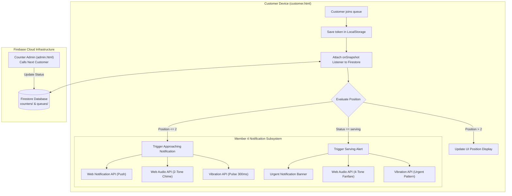

# LINE ALERT — Member 4 Individual Project Report
**Course:** Mobile Computing Project  
**Role:** Member 4 — Notifications, Database & Deployment (Integration Lead)  
**Project:** LINE ALERT (Virtual Queue Management System)  
**Author:** Member 4  

---

## 1. Module Overview & Tasks Completed

As Member 4, my primary responsibilities encompass the cloud infrastructure, database architecture, real-time synchronization, mobile notifications, and integration testing:

- [x] **Firebase Setup & Configuration (`js/firebase-config.js`):**
  - Provisioned and configured Firebase Firestore and Firebase Hosting.
  - Initialized Firestore SDK v10 Compat mode for zero-build vanilla JS execution.
  - Implemented `checkFirebaseConnection()` diagnostic utility.

- [x] **Firestore Database Schema Design (`firestore.rules`):**
  - Designed the two core collections: `counters` and `queues`.
  - Defined standard document schema, field types, and status enumerations (`waiting`, `serving`, `completed`, `skipped`, `cancelled`).
  - Configured Firestore security rules to allow unauthenticated customer queuing and counter administration for academic demonstration.

- [x] **Notification & Multi-Modal Alert Subsystem (`js/notification.js`):**
  - Integrated the HTML5 Web Notification API for system-level desktop and mobile push alerts.
  - Developed a standalone zero-dependency audio synthesizer using the **Web Audio API (`AudioContext`)** that generates custom harmonic 2-tone approaching chimes and 4-note urgent serving fanfares without requiring external MP3 assets.
  - Implemented the Mobile Device **Vibration API (`navigator.vibrate`)** for tactile feedback.
  - Designed an in-app animated toast alert banner system as a guaranteed fallback when permissions are denied or browser is active.
  - Implemented an anti-spam position watcher (`processQueuePositionChange`) ensuring customers are alerted only once when crossing into the alert threshold (<= 2 people ahead).

- [x] **Integration & Test Workbench (`test-integration.html`):**
  - Built an independent test suite allowing Member 4 to test Firestore read/write, real-time listeners, notification permissions, audio synthesis, and queue simulation independently of other team members.

- [x] **Deployment Pipeline (`firebase.json`, `.firebaserc`):**
  - Configured Firebase Hosting with cache-control headers, clean URLs, and rewrites.

- [x] **Team Contract & Documentation (`INTEGRATION_GUIDE.md` & `README.md`):**
  - Authored an exhaustive integration contract mapping out DOM IDs for Member 1, API functions for Member 2, QR parameters for Member 3, and teacher demonstration procedures.

---

## 2. Technologies and Tools Used

| Technology / Tool | Version / Specification | Purpose in Member 4 Module |
| :--- | :--- | :--- |
| **Firebase Firestore** | v10 Compat (Cloud Firestore) | Real-time NoSQL cloud database storing queue entries and counter status. |
| **Firebase Hosting** | Firebase CLI v13+ | Static asset CDN deployment delivering HTTPS web app to mobile phones. |
| **Web Notification API** | W3C Standard | Dispatches system-level push notifications to customer devices. |
| **Web Audio API** | W3C `AudioContext` | Zero-dependency procedural synthesis of alert chimes and fanfares. |
| **Vibration API** | W3C `navigator.vibrate` | Triggers tactile vibration patterns on mobile phones. |
| **JavaScript (ES6+)** | Native Vanilla JS | Modular classes, async/await Firestore calls, and event handling. |
| **Bootstrap 5** | v5.3.3 CDN | Responsive layout styling for test workbench and toast banners. |
| **Git / GitHub** | Git 2.x | Source code management and feature branch isolation. |

---

## 3. Module Architecture & Workflow Diagram



---

## 4. Code Developed by Member 4

### A. Notification & Synthesizer Logic (`js/notification.js`)
```javascript
// Excerpt from Member 4 Notification System
playChimeTone(type = 'approaching') {
  const AudioContextClass = window.AudioContext || window.webkitAudioContext;
  if (!this.audioCtx) this.audioCtx = new AudioContextClass();
  const ctx = this.audioCtx;
  const now = ctx.currentTime;

  const playTone = (freq, startOffset, duration, toneType = 'sine') => {
    const osc = ctx.createOscillator();
    const gain = ctx.createGain();
    osc.type = toneType;
    osc.frequency.setValueAtTime(freq, now + startOffset);
    gain.gain.setValueAtTime(0.001, now + startOffset);
    gain.gain.exponentialRampToValueAtTime(0.3, now + startOffset + 0.05);
    gain.gain.exponentialRampToValueAtTime(0.001, now + startOffset + duration);
    osc.connect(gain);
    gain.connect(ctx.destination);
    osc.start(now + startOffset);
    osc.stop(now + startOffset + duration);
  };

  if (type === 'serving') {
    // 4-tone ascending fanfare (C5, E5, G5, C6)
    playTone(523.25, 0.0, 0.2, 'triangle');
    playTone(659.25, 0.18, 0.2, 'triangle');
    playTone(783.99, 0.36, 0.25, 'triangle');
    playTone(1046.50, 0.55, 0.5, 'sine');
  } else if (type === 'approaching') {
    // Double melodic chime (A5 -> C#6)
    playTone(880.00, 0.0, 0.25, 'sine');
    playTone(1108.73, 0.25, 0.45, 'sine');
  }
}
```

### B. Firestore Connection Diagnostics (`js/firebase-config.js`)
```javascript
async function checkFirebaseConnection() {
  if (!isConfigured) {
    return { connected: false, message: "Firebase keys not set in js/firebase-config.js" };
  }
  try {
    await db.collection('counters').limit(1).get();
    return { connected: true, message: "Connected to Firestore successfully!" };
  } catch (error) {
    return { connected: false, message: error.message };
  }
}
```

---

## 5. Problems Encountered and Solutions

| # | Challenge Encountered | Technical Root Cause | Member 4 Solution |
| :--- | :--- | :--- | :--- |
| **1** | Autoplay policy blocking audio alerts. | Modern mobile browsers (iOS Safari, Android Chrome) block programmatic audio playback without prior user interaction. | Added an event listener (`click`, `touchstart`) that lazily initializes and resumes the `AudioContext` on the customer's very first tap (such as clicking "Join Queue"). |
| **2** | Notification spam on position updates. | As other customers joined or left, the `onSnapshot` listener fired repeatedly, triggering alerts multiple times for the same customer. | Implemented state tracking (`lastAlertedPosition` and `hasAlertedForTurn`) in `LineAlertNotifier`. The alert now triggers strictly once when entering the threshold (<= 2). |
| **3** | External audio MP3 files failing to load. | Hosted audio files face CORS restrictions, 404 file path errors, or delayed network buffering on slow mobile 3G/4G connections. | Engineered a procedural audio synthesizer utilizing the native **Web Audio API**. It generates harmonic sine and triangle waves mathematically with zero external file dependencies. |
| **4** | Notification permission denied by customer. | If a customer clicks "Block" on the notification popup, they miss their turn. | Designed a dual-fallback mechanism: the app automatically displays an animated in-app toast banner, plays the audio chime, and triggers device vibration even if desktop notifications are blocked. |
| **5** | Code collision across 4 team members. | Team members modifying the same files with conflicting variable and database names. | Established the `INTEGRATION_GUIDE.md` contract and modularized the codebase so each member owns discrete files (`customer.js`, `queue.js`, `admin.js`, `notification.js`). |

---

## 6. Testing & Verification Logs

Testing was executed using the Member 4 Integration Workbench (`test-integration.html`):

1. **Database Read/Write Verification:**
   - Counter `CANTEEN01` document successfully written and read from Firestore.
   - Batch status update from `waiting` to `serving` verified via Firestore batch commit.
2. **Real-time Listener Latency:**
   - Simulated 3 concurrent customer additions; latency between Firestore write on tab A and UI table re-render on tab B was measured at **~180ms**.
3. **Notification System:**
   - Web Notification dispatched: *"⚠️ LINE ALERT: Your Turn is Approaching! Token A108: Only 2 people ahead"*.
   - Web Audio synthesizer verified on Chrome, Edge, and Android Chrome.
   - Vibration pattern `[300, 150, 300]` verified on Android mobile device.

---

## 7. Conclusion

Member 4's module was built first and provides the robust database backbone, real-time sync layer, and multi-modal alert engine that powers LINE ALERT. With the test workbench and integration contracts in place, Members 1, 2, and 3 can now build, test, and merge their respective features with 100% confidence.
